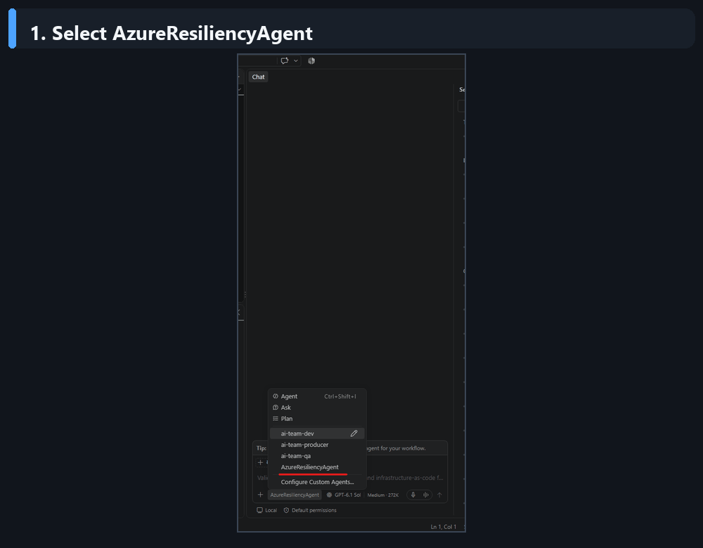

# Azure Resiliency Agent

[](LICENSE)
[](https://agent-plugins.org/)
[](https://azure.microsoft.com/)

Azure Resiliency Agent helps you understand Azure resiliency, assess an application architecture,
generate new zone-resilient infrastructure as code, and review existing Bicep, ARM JSON, or
Terraform before deployment.

The plugin combines a GitHub Copilot agent with the authoritative Azure Resiliency tools in Azure
MCP. The agent gathers repository context and orchestrates the workflow; the hosted Azure
Resiliency service owns the resiliency findings, recommendations, and generated content.

[Learn more about Azure Resiliency Agent in GitHub Copilot.](https://aka.ms/AzureResiliencyAgentInGithubCopilot)

## Where you can use it

- **GitHub Copilot in Visual Studio Code** for repository and file-based workflows.
- **GitHub Copilot CLI** for local terminal workflows.

The plugin currently supports Azure public cloud.

## How it works

The plugin uses Azure MCP to connect GitHub Copilot to Azure Resiliency Agent. Behind the scenes,
Azure MCP uses the default Azure tenant to determine the appropriate Azure data boundary and then
sends the request to the hosted Azure Resiliency Agent.

This is the same Azure Resiliency Agent experience available through
[Microsoft Copilot in Azure](https://learn.microsoft.com/en-us/azure/copilot/resiliency-agent),
scoped to the focused capabilities included with this plugin.

## Before you start

- You need access to GitHub Copilot and Agent Plugins in your selected experience.
- [Node.js](https://nodejs.org/) must be installed with `npx` available on your `PATH`. The first
  Azure Resiliency tool call downloads the pinned Azure MCP package from npm.
- Open the application repository or folder you want to assess. This lets the agent discover related
  templates, modules, parameter files, and architecture documents.

## Installation

### Visual Studio Code

1. Open the **Extensions** view.
2. Search for:

   ```text
   @agentPlugins azure-resiliency-agent
   ```

3. Select **Azure Resiliency Agent** and choose **Install**.
4. Open GitHub Copilot Chat.
5. Select **AzureResiliencyAgent** from the agent picker.

If Agent Plugins are not visible, enable the VS Code setting `chat.plugins.enabled`.

### GitHub Copilot CLI

Install from the Awesome Copilot marketplace:

```bash
copilot plugin install azure-resiliency-agent@awesome-copilot
```

Start GitHub Copilot CLI with the agent selected:

```bash
copilot --agent azure-resiliency-agent:AzureResiliencyAgent
```

You can also select **AzureResiliencyAgent** from the interactive `/agent` menu.

## Start a conversation

After installation:

1. Open the repository or folder you want to assess.
2. Open GitHub Copilot Chat or GitHub Copilot CLI and select **AzureResiliencyAgent**.
3. Ask a resiliency question, describe an architecture, or select the templates you want reviewed.
4. If files are needed, review each displayed path and choose **Share**.
5. Answer any clarification questions, then review the proposed and applied changes.



## What's included

The plugin provides one customer-facing agent backed by seven Azure MCP tools.

| Azure MCP tool | What it does |
| --- | --- |
| `resiliencyagent_guidance_get` | Explains Azure resiliency, high availability, availability zones, zone resilience, and zone redundancy. |
| `resiliencyagent_file_attach` | Prepares one explicitly approved local file for a later architecture assessment or template review. |
| `resiliencyagent_architecture_assess` | Assesses a described Azure application architecture for availability-zone resiliency gaps. |
| `resiliencyagent_iac_generate` | Generates new zone-resilient Bicep, ARM JSON, or Terraform for a described application. |
| `resiliencyagent_bicep_review` | Reviews existing Bicep, local modules, and parameter files and returns corrected content. |
| `resiliencyagent_arm_review` | Reviews existing ARM JSON templates and parameter files and returns corrected content. |
| `resiliencyagent_terraform_review` | Reviews existing Terraform root modules, local child modules, variables, and provider constraints and returns corrected content. |

## Common workflows

### Ask a resiliency question

Use the agent for conceptual guidance before you have an architecture or template:

```text
What is the difference between high availability, zone redundancy, and zone resilience in Azure?
```

### Assess an application architecture

Describe the architecture and include known regions, SKUs, dependencies, availability requirements,
and constraints:

```text
Assess an App Service API, PostgreSQL Flexible Server, and Redis architecture in East US 2 for
availability-zone resiliency.
```

You can also attach an architecture diagram or document. The agent asks for permission before sharing
each selected local file.

### Generate new resilient infrastructure as code

State the application architecture, target region, desired format, naming requirements, and
dependencies:

```text
Generate zone-resilient Bicep for an App Service API with PostgreSQL and Redis in East US 2.
```

The agent can generate Bicep, ARM JSON, or Terraform. If the format or another material input is
missing, the Azure Resiliency service asks a clarification question before continuing.

### Review existing Bicep, ARM JSON, or Terraform

Open the repository containing the templates and ask the agent to review the relevant entry file:

```text
Review main.bicep, its local modules, and parameter file for availability-zone resiliency. Preserve
the existing resource names, parameters, and module relationships.
```

For file-based reviews, the agent:

1. Discovers the entry file and related local files.
2. Asks for approval before sharing each selected file.
3. Sends the approved files together to the matching Azure Resiliency review tool.
4. Presents the findings and returned files for your review.
5. Applies corrected content to an existing file only when the mapping is unambiguous.

## Using local files

When an assessment or template review needs a local file, the agent shows you the file it wants to
use and asks for your approval. Nothing is shared until you choose **Share**.

Only the files you approve are sent to Azure Resiliency Agent for the current assessment or review.
You can decline any request. Before sharing, confirm that the displayed file is relevant and does
not contain credentials or other sensitive information.

## Results and generated files

Depending on the request, the Azure Resiliency service may return:

- A conversational answer or a clarification question.
- An architecture assessment with prioritized resiliency findings.
- A detailed recommendation report.
- New Bicep, ARM JSON, or Terraform.
- Corrected content for existing infrastructure-as-code files.
- Suggested next steps for continuing the same conversation.

When a detailed recommendation report is returned, the agent preserves its exact content in the
workspace under `azure-resiliency/` and provides a clickable link. Generated and corrected templates
are presented through native file and diff workflows so you can review them before committing or
deploying anything.

## Example prompts

```text
How should I begin improving the resiliency of a new Azure application?
```

```text
Use this architecture diagram to identify availability-zone resiliency gaps before deployment.
```

```text
Generate resilient Terraform for a web application with App Service and PostgreSQL.
```

```text
Review the ARM templates in this folder together and make only the changes required for zonal
resilience.
```

```text
Correct the attached Terraform while preserving resource addresses, variables, and provider
constraints.
```

## Security

Do not report security vulnerabilities through public GitHub issues. See [SECURITY.md](SECURITY.md).

## Contributing

This plugin is maintained by the Azure Resiliency Agent team. Contributions and documentation
improvements are welcome through GitHub issues and pull requests.

## License

MIT. See [LICENSE](LICENSE).
